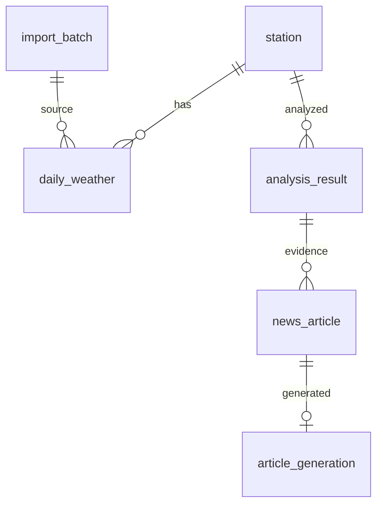

# 실제 기상 관측 CSV → MySQL → 근거 → 기사 초안

기존 Python CLI의 `import-csv → compare → save-article` 흐름을 유지합니다. `save-article`은 사람이 쓴 본문을 저장하는 기존 명령입니다. 이번 버전에서 `generate-article`을 추가하여 같은 근거로 **템플릿 / 무료 로컬 Hugging Face / OpenAI API** 중 한 방식을 고를 수 있습니다. FastAPI 브라우저 실습 화면을 추가하되, 기존 CLI 명령과 DB 기능을 유지합니다. 예보 기능은 추가하지 않습니다.

## 0. VS Code에서 브라우저로 먼저 실행하기 (MySQL 불필요)

이번 추가 기능은 **FastAPI 서버 + 기사 실습 화면**입니다. 자전거 실습과 같이 `CSV → Python facts → /articles → 브라우저` 순서이며, 기존 CLI와 MySQL 저장 기능은 그대로입니다. 웹 실습의 기본 자료는 저장소에 이미 포함된 **실제 ASOS 48행 발췌**입니다. 전체 1,008행 원본과 혼동하지 마세요.

### Windows · 무료 사전 점검

1. GitHub에서 최신 `main`을 받습니다. VS Code의 **파일 → 폴더 열기**로 `weather-history-mysql-lab` 폴더를 엽니다.
2. **터미널 → 새 터미널**에서 아래 명령을 한 줄씩 실행합니다. Python 3.10 이상이 필요합니다. `.venv`가 이미 있으면 첫 줄을 생략합니다. 가상환경 활성화/PowerShell 실행 정책 변경 없이 실행할 수 있습니다.

```powershell
py -m venv .venv
.venv\Scripts\python.exe -m pip install -r requirements-api.txt
.venv\Scripts\python.exe start_api.py --offline
```

3. 터미널은 켜 둔 채 브라우저 주소창에 **http://127.0.0.1:8000/** 을 입력합니다. `index.html` 파일을 직접 열거나 Live Server로 열지 않습니다.
4. 왼쪽의 **24.64℃ · 완전한 1일 · 24시간**과 **전체 48행 중 불완전한 2일 제외**를 확인합니다. 기간은 2026-09-01~03이며 실제 포함 날짜는 9월 2일입니다.
5. 기본 `template`를 유지하고 **초안 만들기**를 누릅니다. 이는 AI를 호출하지 않는 고정 문장 사전 점검입니다.
6. 근거 JSON, 기사, 응답의 `facts_sha256`, `DRAFT`, `human_review_required`를 대조합니다. **JSON 내려받기 / TXT 내려받기**로 본인 컴퓨터에 보관할 수 있습니다.
7. 서버 종료는 터미널에서 **Ctrl+C**입니다. 재실행하면 이전 화면의 초안은 복구되지 않으므로 필요한 파일을 먼저 내려받습니다.

macOS/Linux에서는 첫 줄을 `python3 -m venv .venv`로, 이후 `.venv\Scripts\python.exe`를 `.venv/bin/python`으로 바꿉니다. 8000번 포트를 다른 앱이 쓰면 `--port 8001`을 붙이고 브라우저 주소도 8001로 바꿉니다.

### API 문서에서도 같은 요청 보내기

http://127.0.0.1:8000/docs 에서 **POST /articles → Try it out**을 선택하고 다음 본문으로 **Execute**를 누릅니다.

```json
{"mode": "template"}
```

- `GET /health`: 서버 상태·선택 모델·키 설정 여부·HF 활성 여부. `live_api_verified=false`는 실제 유료 호출을 검증하지 않았다는 뜻입니다. `status=ok`만으로 CSV나 계정이 정상이라는 의미는 아닙니다.
- `GET /facts`: 모델 호출 없이 CSV 검증·집계 결과 확인.
- `POST /articles`: `mode`는 `template`, `openai`, `huggingface`. 선택적으로 `max_tokens` 128~4096, `timeout` 1~120초를 지정합니다. timeout은 OpenAI 요청에만 적용되며 HF 전체 실행시간 제한은 아닙니다.
- HTTP 요청에 CSV 경로·모델 이름·API 키를 넣지 않습니다. 알 수 없는 필드는 422로 거부합니다. 키는 문서의 Authorize나 JSON 본문에 입력하지 않습니다.
- 서버는 브라우저 요청으로 파일이나 DB에 자동 저장하지 않습니다. 저장소의 기존 `generate-article` CLI는 JSON/TXT와 선택적 MySQL 저장을 계속 지원합니다.

`/docs`의 Swagger UI는 CDN 자산을 불러옵니다. CDN 접속이 막히면 `/` 실습 화면은 외부 CSS/JS 없이 작동하므로 그 화면으로 계속할 수 있습니다.

### OpenAI 선택 실습 · 본인 키를 세션에만 입력

무료 점검을 마친 뒤 서버를 Ctrl+C로 종료합니다. 별도 API 계정·권한·잔액과 요금을 확인하고 선택적으로 실행합니다.

```powershell
.venv\Scripts\python.exe -m pip install -r requirements-openai.txt
.venv\Scripts\python.exe start_api.py
```

- 비표시 입력 안내에서 **본인 키를 터미널에 직접 붙여넣습니다**. 화면에 글자가 보이지 않아도 정상입니다. Enter만 누르면 키 없이 시작합니다. 비표시 입력을 지원하지 않는 환경에서는 중단하며 일반 입력으로 바꾸지 않습니다.
- 프로그램은 키를 현재 서버 프로세스의 환경변수에만 넣고 파일·브라우저·로그에 저장하지 않습니다. 기존 환경변수에 키가 있으면 입력을 생략합니다. `.env`는 이 웹 서버에서 읽지 않습니다. 키를 채팅·소스·Git·스크린샷에 넣지 마세요.
- 브라우저에서 `openai`를 고르고 **초안 만들기**를 누릅니다. 유료 호출/집계 근거 전송 확인 후 실행합니다. `/docs`의 Execute도 실제 유료 요청을 보낼 수 있습니다.
- 기본 모델은 `gpt-5.4-mini-2026-03-17`입니다. Responses API, `reasoning.effort=none`, strict JSON Schema, `store=False`, 자동 재시도 0회를 사용합니다. `temperature`는 보내지 않습니다. 모델만 바꾸려면 서버 시작 전 `OPENAI_MODEL`을 설정합니다. 사용자 지정 모델의 Responses/JSON Schema 호환성은 별도 확인이 필요합니다.
- 요청마다 비용이 발생할 수 있습니다. 타임아웃·브라우저 닫기·재실행이 이미 발생한 비용을 취소하지는 않습니다. 중복 클릭은 화면과 서버에서 막지만 완료 후 다시 누르면 새 요청입니다.

### Hugging Face 선택 실습 · 명시적 설치와 활성화

```powershell
.venv\Scripts\python.exe -m pip install -r requirements-hf.txt
.venv\Scripts\python.exe start_api.py --enable-huggingface
```

키 입력에서는 Enter만 누릅니다. 브라우저에서 `huggingface`를 고르고 다운로드 안내를 확인합니다. `Qwen/Qwen2.5-1.5B-Instruct`와 고정 revision을 사용하며 처음에 수 GB를 내려받습니다. CPU는 느리고 메모리 여유가 필요합니다. 앱 시작/template 실행만으로 torch/transformers를 불러오거나 가중치를 내려받지 않습니다. 설치되지 않았거나 활성화하지 않았다면 오류를 보여주며 template 성공으로 바꾸지 않습니다. `--offline`과 `--enable-huggingface`는 함께 사용할 수 없습니다. `--offline`은 키와 HF 활성 환경변수를 모두 제거합니다.

### 본인 시간 CSV로 바꾸기

원본을 `data/raw/asos_hourly.csv`에 두고 서버를 다시 시작합니다. HTTP나 브라우저로 파일을 업로드하는 기능은 아닙니다.

```powershell
$env:WEATHER_CSV_PATH = "data/raw/asos_hourly.csv"
$env:WEATHER_STATION = "108"
.venv\Scripts\python.exe start_api.py --offline
```

상대 경로는 실습 폴더 기준이며 웹 실습은 최대 10 MiB·100,000행을 받습니다. 여러 관측소가 있으면 `WEATHER_STATION`을 지정합니다. 기본 48행으로 돌아가려면 `Remove-Item Env:WEATHER_CSV_PATH -ErrorAction SilentlyContinue` 후 서버를 다시 실행합니다. 설정한 CSV가 없거나 잘못되어도 동봉 자료로 몰래 대체하지 않습니다. 일자료/DB 월 비교는 아래 CLI 절차를 따릅니다.

### 오류를 만났을 때

| 응답 | 확인할 내용 |
|---|---|
| 422 | 요청 필드/범위 또는 CSV의 필수 열·중복·관측소·완전한 날짜 |
| 503 | API 키/SDK가 없음, 또는 HF 모드가 비활성 |
| 429 | 이미 생성 중이거나 OpenAI의 요청·잔액·사용량 제한 |
| 502 | 인증/접근/모델 실행 실패, 잘린 응답, 기사 형식·관측소·숫자 검증 실패 |
| 504 | OpenAI 대기시간 초과. 재시도 전 사용 내역 확인 |
| 400 / 403 / 413 / 415 | 잘못된 Host / 다른 웹 출처 / 요청 4 KiB 초과 / JSON 아닌 요청 |

오류에서는 이전 초안을 새 성공 결과처럼 보여주지 않으며 외부 오류 본문·입력 키를 반사하지 않습니다. 이 서버는 **127.0.0.1에만 바인딩하는 1인 로컬 수업용**입니다. 인증·영구 작업 큐·공용 배포용 속도 제한이 없으므로 `0.0.0.0`, 포트 공개, 여러 worker, 외부 배포에 사용하지 않습니다.


## 1. 먼저 데이터 종류를 구분합니다

| 입력 | 사용할 명령 | 할 수 있는 분석 |
|---|---|---|
| ASOS **일자료**, `평균기온(℃)`, 날짜만 있는 `일시` | `import-csv` → `compare` | 서로 다른 두 해의 같은 달 비교. 두 달 모두 완전해야 함 |
| ASOS **시간자료**, `기온(°C)`, 날짜+시간의 `일시` | `summarize-hourly` | 완전한 날짜의 시간 관측 기온 평균. CSV/JSON 파일만 사용 |

시간자료를 일자료 테이블에 넣거나 `기온`을 `평균기온`으로 이름만 바꾸면 안 됩니다. 코드가 잘못된 입력 종류를 설명하고 중단합니다.

### 제공된 실물 시간 CSV의 적합성

사용자가 제공한 `OBS_ASOS_TIM_20261014010601.csv`를 실제로 검사했습니다. 원본은 Git에 포함하지 않습니다.

- CP949, 38개 열, 1,008행, 서울(108)
- 2026-09-01 01:00~2026-10-13 00:00, 중복 시각/기온 결측 없음
- KST의 **00:00~23:00**을 한 날짜로 삼으면 완전한 날짜는 2026-09-02~2026-10-12, **41일·984시간**입니다.
- 첫날 23시간, 마지막 날 1시간은 평균에서 제외합니다. 원본의 행은 수정하지 않습니다.
- 완전한 날짜의 시간 관측 기온 산술평균: **21.38℃**. 이는 공식 일평균기온·월평균기온이 아닙니다.
- 한 해의 시간자료이므로 기존의 전년 동월 비교에는 부족합니다. 두 해의 **일자료**가 추가로 필요합니다.

ASOS의 시각 표기는 [기상청 APIHub의 시간자료 KST 설명](https://apihub.kma.go.kr/apiList.do)을 따릅니다. CSV 문자열 자체에는 UTC offset이 없어 `Asia/Seoul`로 해석했다는 근거를 JSON에 기록합니다. 다운로드 기간의 01시~다음 날 00시 경계와 여기서 선택한 00~23시 집계 경계를 혼동하지 않습니다.

실물 원본에서 48행·5개 열을 추출한 작은 [테스트 fixture](tests/fixtures/README.md)를 동봉합니다. 추출 방법·원본/발췌 해시·출처를 기록했으며 가상 관측값을 만들지 않았습니다. 포털 재다운로드로 원본의 모든 값을 대조한 것은 아닙니다.

## 2. 일자료 확보와 설치

공식 출처: [기상자료개방포털 ASOS](https://data.kma.go.kr/data/grnd/selectAsosRltmList.do?pgmNo=36)

1. 필요하면 사용자가 포털에 로그인합니다.
2. ASOS, 자료형태 **일**, 지점 **서울**, 요소 **평균기온**을 선택합니다.
3. 완전한 자료가 있는 서로 다른 두 해의 같은 달을 각각 내려받습니다. 아래는 2025년/2026년 9월 예시입니다.
4. `data/raw/seoul_2025_09.csv`, `data/raw/seoul_2026_09.csv`로 보관합니다.
5. 실제 헤더와 지점 코드를 확인합니다. 예시의 `108`은 서울입니다.

| CSV 열 | DB 열 |
|---|---|
| 지점 | station_id |
| 지점명 | station_name |
| 일시 (YYYY-MM-DD) | observed_date |
| 평균기온(℃) | avg_temp_c |

영문 헤더 `station_id,station_name,observed_date,avg_temp_c`, UTF-8 BOM/CP949, 헤더의 공백과 °C/℃ 차이를 지원합니다. 추가 열은 무시하되 행의 열 개수 오류를 거부합니다. 빈 기온은 NULL이며 0℃와 구분합니다. -999, NaN, 소수 2자리 초과 값은 중단합니다. 정제가 필요하면 원본을 보존하고 별도 파일에 작업하세요.

### Windows PowerShell

MySQL 8.0.16 이상(CHECK 적용), Workbench, Python 3.10 이상이 필요합니다. `weather-history-mysql-lab` 폴더에서 실행합니다.

```powershell
py -m venv .venv
.venv\Scripts\python.exe -m pip install -r requirements.txt
Copy-Item .env.example .env
```

`.env`의 `MYSQL_*`를 본인 실습 DB에 맞게 수정합니다. 실제 비밀번호/API 키를 Git에 올리지 않습니다. 새 DB는 Workbench에서 `schema.sql` 전체를 실행합니다. 기존 테이블을 삭제하지 않으며 6개 테이블을 생성합니다.

**기존 버전 사용자:** 기존 DB를 백업한 뒤 `migration_article_generation.sql`을 실행합니다. `CREATE TABLE IF NOT EXISTS`만 다시 실행하면 기존 작성자 CHECK가 바뀌지 않습니다. 마이그레이션은 `TEMPLATE` 작성자를 허용하고 생성 이력 테이블을 추가하며 관측/기사 행을 지우지 않습니다. MySQL DDL은 암묵적 커밋이 발생할 수 있으므로 중간 오류가 나면 결과를 확인한 뒤 재실행하세요.

## 3. 일자료 검증 → DB 저장 → 두 해 비교

```powershell
.venv\Scripts\python.exe weather_lab.py import-csv data/raw/seoul_2025_09.csv --validate-only
.venv\Scripts\python.exe weather_lab.py import-csv data/raw/seoul_2026_09.csv --validate-only
.venv\Scripts\python.exe weather_lab.py import-csv data/raw/seoul_2025_09.csv
.venv\Scripts\python.exe weather_lab.py import-csv data/raw/seoul_2026_09.csv
.venv\Scripts\python.exe weather_lab.py compare --station 108 --baseline-year 2025 --target-year 2026 --month 9
```

- 파일 SHA256이 같으면 재저장을 생략합니다. 다른 파일의 동일 관측소·날짜·기온도 행을 생략합니다.
- 이미 저장된 날짜의 값이 다르면 자동 덮어쓰기하지 않고 파일 전체를 rollback합니다.
- 파일명·SHA256·출처·수집 시각을 보존합니다. 기온 범위 검사는 교육용 입력 검사이며 공식 품질 판정이 아닙니다.
- 비교 근거는 `analysis_result`와 `data/results/fact_sheet.json`에 저장되고 `analysis_id`가 출력됩니다.
- 월 평균 = 일평균기온 합 / 전체 날짜 수. 차이 = 대상 해 평균 − 기준 해 평균. 평균의 차이를 먼저 구한 뒤 소수 둘째 자리로 반올림합니다. 표시 평균끼리의 차이와 0.01℃ 다를 수 있습니다.
- 두 달의 모든 날짜/기온이 있어야 저장합니다. 빠진 날짜, NULL, 미래/진행 중인 달은 중단합니다. 공식 월 통계 산출 절차를 구현한 것은 아닙니다.

`queries.sql`에서 JOIN, 유효 일수, 완전한 달의 평균 차이, 기사 근거를 확인합니다. SQL 조건을 실제 관측소·연도·월에 맞추세요.

## 4. 시간 CSV로 즉시 실습하기 (DB 불필요)

제공받은 원본을 `data/raw/asos_hourly.csv`로 복사하거나 실제 파일 경로를 인수로 전달합니다.

```powershell
.venv\Scripts\python.exe weather_lab.py summarize-hourly data/raw/asos_hourly.csv --station 108 --output data/results/hourly_facts.json
.venv\Scripts\python.exe weather_lab.py generate-article --facts data/results/hourly_facts.json --mode template --output data/results/hourly_template.json
```

완전한 날짜는 정시 24개, 기온 결측 없음, 비어 있지 않은 기온 QC 플래그 없음으로 정의합니다. QC 코드의 의미를 추측하지 않고 플래그가 있는 날짜는 검토 대상으로 제외하는 보수적인 교육용 정책입니다. 날짜 전체가 빠져도 누락으로 기록합니다. 임의 보간하지 않습니다. 원본 CSV와 같은 출력 경로(심볼릭 링크 포함)는 거부하고, 이미 있는 근거 출력은 `--overwrite`를 지정해야 교체합니다. `included_dates`, `excluded_dates`, `coverage`에 선택/제외 이유를 남깁니다. 여러 관측소가 있으면 `--station`을 지정합니다.

`--facts`로 만든 시간자료 기사는 **파일로만 저장**합니다. 기존 일자료 비교 테이블에는 억지로 연결하지 않습니다.

## 5. 같은 근거로 고르는 세 가지 기사 작성 방식

### A. template: 기본값, 무료, API·모델 설치 없음

```powershell
.venv\Scripts\python.exe weather_lab.py generate-article --facts data/results/fact_sheet.json --mode template --output data/results/template_article.json
```

검증된 수치를 정해진 한국어 문장에 넣습니다. 기존의 사람 작성·저장 기능에 새로 추가한 선택지입니다.

### B. huggingface: 공개 모델을 내 컴퓨터에서 무료 추론

기본값은 **[Qwen/Qwen2.5-1.5B-Instruct](https://huggingface.co/Qwen/Qwen2.5-1.5B-Instruct)**입니다. 공식 모델 카드에 한국어 지원이 명시된 1.54B 규모의 Apache-2.0 모델로, 가벼운 수업용 시작점입니다. 모든 한국어 기사에 가장 우수하다는 의미는 아닙니다. 기본 revision은 `989aa7980e4cf806f80c7fef2b1adb7bc71aa306`으로 고정했습니다.

```powershell
.venv\Scripts\python.exe -m pip install -r requirements-hf.txt
.venv\Scripts\python.exe weather_lab.py generate-article --facts data/results/hourly_facts.json --mode huggingface --output data/results/hf_article.json
```

- Hugging Face API 토큰이나 유료 Hosted Inference를 사용하지 않습니다. 모델 이용 요금은 없지만 컴퓨터/클라우드 GPU 이용료는 별개입니다.
- **최초 실행 시 수 GB 가중치를 다운로드**합니다. 디스크/메모리를 먼저 확인하세요. CPU float32 가중치만 대략 6GB이며 실행 여유 메모리가 더 필요합니다. CPU는 느릴 수 있습니다.
- CUDA는 float16, CPU는 float32를 사용합니다. `trust_remote_code=False`, `use_safetensors=True`로 모델 저장소의 임의 Python 코드를 실행하지 않습니다.
- 다운로드 연결 제한은 기본 30초이며 `HF_HUB_DOWNLOAD_TIMEOUT`/`HF_HUB_ETAG_TIMEOUT`으로 조정합니다. 로컬 추론 전체 실행 시간은 하드 타임아웃으로 보장하지 않습니다.
- `HF_MODEL`, 선택적인 `HF_REVISION` 또는 `--model`로 바꿀 수 있습니다. 사용자 지정 모델의 라이선스/메모리/채팅 템플릿 호환성은 별도 확인이 필요합니다.

### C. openai: 별도 API 요금이 발생하는 초안

기본값은 **[gpt-5.4-mini-2026-03-17](https://developers.openai.com/api/docs/models/gpt-5.4-mini)**입니다. 한국어 지시 기반 짧은 초안에 적합한 경량 모델의 고정 스냅샷을 사용합니다. OpenAI Responses API를 호출합니다.

```powershell
.venv\Scripts\python.exe -m pip install -r requirements-openai.txt
# 본인 세션 환경변수에 OPENAI_API_KEY가 설정된 경우의 기존 CLI입니다.
# 브라우저 실습은 위 start_api.py 비표시 입력을 권장합니다.
.venv\Scripts\python.exe weather_lab.py generate-article --facts data/results/hourly_facts.json --mode openai --timeout 60 --max-tokens 900 --output data/results/openai_article.json
```

- ChatGPT 구독과 별도인 API 계정, 모델 접근 권한, 과금 설정이 필요합니다. 호출 전에 본인 계정의 요금과 한도를 확인하세요.
- OpenAI로 보내는 항목: 관측소 이름, 기간, 지표·단위·집계 수치, 공개 출처 URL, 해석 한계입니다. 원본 CSV, 로컬 파일명·해시, DB ID는 보내지 않습니다.
- `store=False`로 요청하고 자동 재시도를 끕니다. 이것만으로 모든 서버 로그/보존 정책이 없어지는 것은 아닙니다.
- `--timeout`은 OpenAI 요청의 제한 시간(1~300초), `--max-tokens`는 출력 상한(128~4096)입니다. 비용이 발생한 응답의 저장 오류를 막으려면 출력 경로를 먼저 확인하세요.
- `OPENAI_MODEL` 또는 `--model`로 바꿀 수 있으나 Responses/strict JSON Schema 지원 여부를 확인해야 합니다.

### 공통 저장·검토 규칙

모든 방식은 `DRAFT`입니다. JSON에는 기사, 근거 스냅샷, 해시, 모드, 모델/revision, 프롬프트 버전, 보조 검사 결과를 보존하고 같은 위치에 읽기 쉬운 `.txt`를 만듭니다. 기존 출력은 기본적으로 덮어쓰지 않으며 필요한 경우에만 `--overwrite`를 사용합니다.

AI 응답이 비었거나 잘린 경우, JSON 형식 오류, 근거에 없는 아라비아 숫자/비율 표현은 중단합니다. 실패를 템플릿 성공으로 바꾸지 않습니다. **숫자 허용 목록과 관측소 이름 포함 검사는 완전한 사실 검증이 아닙니다.** 숫자 연결 오류, 한글 수사, 잘못된 인과관계, 누락은 사람이 확인해야 합니다. `semantic_fact_check=NOT_PERFORMED`와 `human_review_required=true`를 남깁니다. 외부 모델의 실제 기사 품질은 이번 오프라인 테스트로 평가하지 않았습니다.

DB에 저장된 월 비교 근거를 읽고 생성 이력까지 함께 저장하려면:

```powershell
# 1을 실제 analysis_id로 바꿉니다. mode만 바꾸어 같은 근거로 비교할 수 있습니다.
.venv\Scripts\python.exe weather_lab.py generate-article --analysis-id 1 --mode template --save-to-db --output data/results/db_template.json
```

`--save-to-db`는 `--analysis-id`와 함께만 가능합니다. 템플릿은 `TEMPLATE`, 모델 기사는 `AI` 작성자로 `news_article`에 저장하며 `article_generation`에 당시 근거·모델·검사 결과를 연결합니다. 기사와 생성 이력 저장은 한 트랜잭션입니다. 모델 호출 중 DB 근거가 달라지면 저장을 중단합니다. 파일을 먼저 남기므로 DB 저장 실패 시 API를 재호출하기 전에 저장된 JSON을 확인하세요.

## 6. 기존 사람이 쓴 기사 저장

근거를 보고 본문을 UTF-8 파일에 직접 작성한 뒤 저장합니다.

```powershell
.venv\Scripts\python.exe weather_lab.py save-article --analysis-id 1 --title "직접 작성한 기사 제목" --lead "직접 작성한 리드" --body data/results/article.txt
```

기존대로 `HUMAN/DRAFT`입니다. 모델 초안을 사람 작성 원고로 그대로 가장하여 저장하지 말고, 생성 출처는 `generate-article --save-to-db`로 보존하세요.

## 7. ERD와 SQL 학습 포인트



- PK/FK/UNIQUE/CHECK로 존재하는 근거, 날짜·파일 해시 중복, 작성자/상태/생성 방식을 검사합니다.
- `ON DELETE RESTRICT`로 기사가 연결된 근거 삭제를 막습니다. 실제 SQL 키워드는 `RESTRICT`입니다.
- 기사에서 분석·관측소·생성 이력을 JOIN하여 값과 문장의 연결을 점검합니다.
- 두 기간으로 장기 기후변화, 통계적 유의성, 변화 원인을 단정하지 않습니다.

## 8. 테스트와 검증 범위

```powershell
.venv\Scripts\python.exe -m pip install -r requirements-api.txt -r requirements-openai.txt
.venv\Scripts\python.exe -m unittest discover -s tests -v
.venv\Scripts\python.exe -m compileall -q weather_lab.py article_generation.py hourly_weather.py app.py start_api.py
```

오프라인 테스트 **64개가 통과**했습니다. 기존 46개 회귀 검사와 API/런처 검사 18개입니다. FastAPI TestClient에서 실제 48행을 집계하고 무료 template, 모델 SDK mock, API 오류·입력 제한·출처 차단·키 비표시 입력·중복 생성 잠금을 확인합니다. CSV/월 비교/시간 coverage, 실물 발췌의 24.64℃ 평균, 세 모드 선택, 숫자·형식 검사, API 미설정·타임아웃·불완전 응답, 원본 덮어쓰기 차단·불가능한 coverage 거부·중첩 개인정보 필드 제외·호출 전 출력 경로 검사, HF 입력/출력 토큰 분리와 안전한 로딩 옵션, DB 트랜잭션 계약을 오프라인 검사합니다. 모델 SDK는 mock으로 검사하며 API 요금이나 모델 다운로드가 발생하지 않습니다. 오류 테스트의 가상 수치는 관측 데이터가 아닙니다.

실물 원본 전체의 41일/984시간/21.38℃ 계산과 템플릿 생성은 별도로 실행했습니다. **이번 검증은 Linux에서 수행했습니다. Windows 실기 실행, 실제 MySQL 서버 실행, 실제 HF 가중치 추론, 유료 OpenAI 호출은 수행하지 않았습니다.** 사용자 DB에서 스키마/마이그레이션, 동일 파일 재입력, SQL과 JSON 평균 대조, 생성 기사/이력 JOIN을 확인하세요. PostgreSQL 포트는 별도 `postgre` 브랜치의 `weather-history-postgre-lab`에 있습니다.

### 모델 설정의 공식 근거

2026-10-14 수업 준비 시 [GPT-5.4 mini 공식 모델 문서](https://developers.openai.com/api/docs/models/gpt-5.4-mini)에서 고정 스냅샷, Responses, Structured Outputs, reasoning none 지원을 확인했습니다. [Structured Outputs 가이드](https://developers.openai.com/api/docs/guides/structured-outputs)에 따라 title/lead/body 문자열만 받는 strict JSON Schema를 사용합니다. 출력 형식 보장은 기사 내용의 진실성 보장이 아닙니다. SDK mock 통과는 실제 계정의 모델 접근·잔액·응답 품질 검증이 아닙니다.
